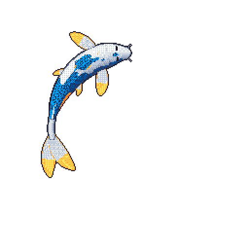

  

<a href="https://github.com/fakhar-ud-din">
  <picture>
    <source media="(prefers-color-scheme: dark)" srcset="cards/stats-dark.svg">
    
  </picture>
</a>
<a href="https://github.com/fakhar-ud-din?tab=repositories">
  <picture>
    <source media="(prefers-color-scheme: dark)" srcset="cards/languages-dark.svg">
    
  </picture>
</a>
 
